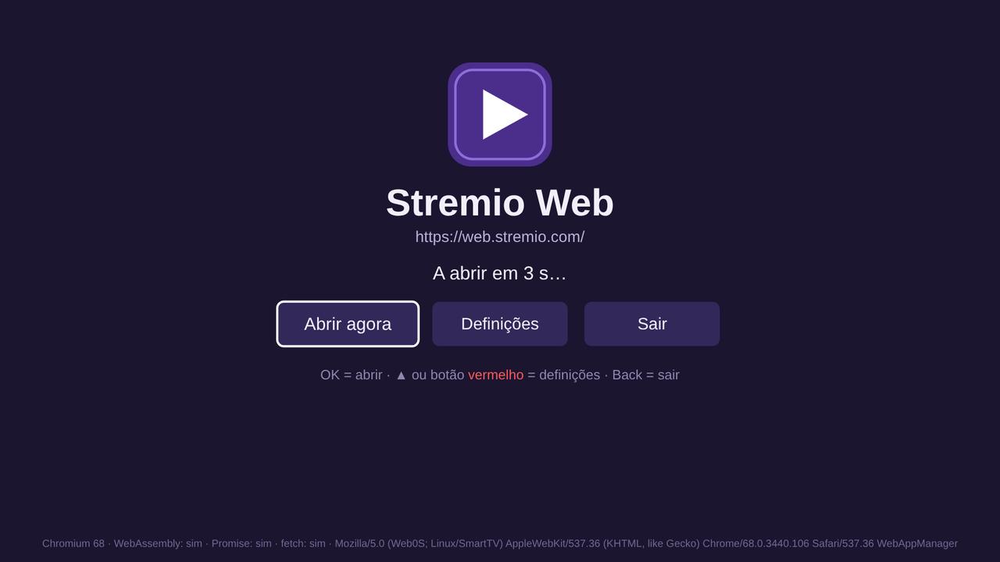
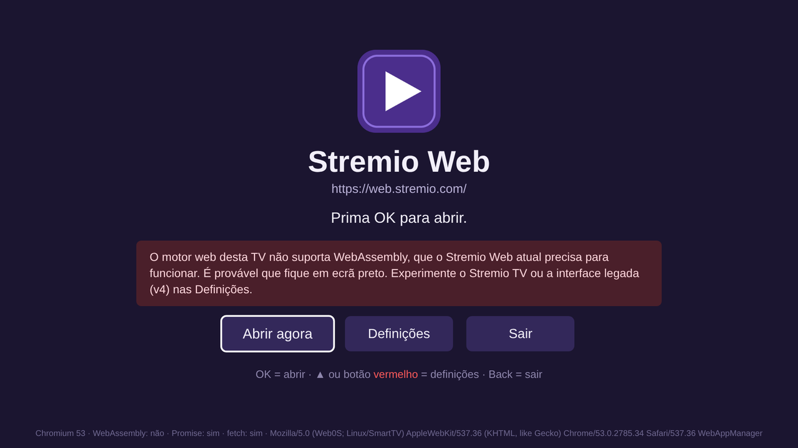
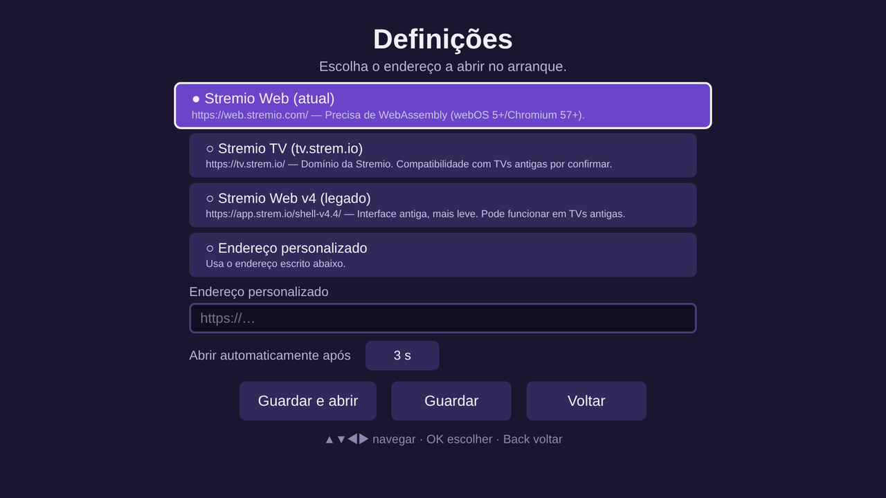

# Stremio Web para TVs LG (webOS) anteriores a 2020

Aplicação webOS (um *wrapper*) que permite abrir o **[web.stremio.com](https://web.stremio.com)**
numa televisão LG que não tem a app oficial do Stremio. Instala-se na TV como
qualquer outra app, aparece na barra de aplicações e, ao ser aberta, mostra um ecrã de
arranque que verifica a compatibilidade da TV e depois carrega o Stremio Web em ecrã inteiro.

> Projeto pessoal e não oficial, sem ligação à Stremio. A app não altera nem
> redistribui o Stremio: apenas abre o site público no navegador interno da TV.

## Screenshots

| Ecrã de arranque | Aviso de incompatibilidade | Definições |
|---|---|---|
|  |  |  |

## Funcionalidades

- **Abre o Stremio Web em ecrã inteiro** (1920×1080), sem barra de endereços.
- **Arranque automático** com contagem decrescente configurável (imediato, 3 s, 5 s, 10 s ou nunca).
- **Deteção de compatibilidade:** mostra a versão do Chromium da TV e se suporta
  WebAssembly, Promise e fetch. Se a TV não for compatível, avisa em vez de abrir uma página preta.
- **Verifica a ligação à Internet** antes de abrir.
- **Vários endereços à escolha:**
  - Stremio Web atual (`https://web.stremio.com/`);
  - Stremio TV (`https://tv.strem.io/`), num domínio da Stremio (ainda não
    se confirmou se funciona em TVs antigas);
  - interface legada v4 (`https://app.strem.io/shell-v4.4/`), mais leve;
  - endereço personalizado (por exemplo uma instância própria do
    [stremio-web](https://github.com/Stremio/stremio-web)).
- **Tudo controlável pelo comando:** setas, OK, Back e botões coloridos, ou o ponteiro do Magic Remote.
- **As definições ficam guardadas** na TV (localStorage).
- **Botão Back integrado:** dentro do Stremio volta à página anterior; no início sai da app.
- **Código compatível com TVs antigas:** JavaScript ES5 puro e CSS simples, que funcionam do webOS 1.x ao 4.x.
- **Compilação automática:** cada push para o GitHub gera o ficheiro `.ipk` (GitHub Actions).

## Compatibilidade

O Stremio Web atual (v5) precisa de **WebAssembly**, que só existe a partir do Chromium 57.
O motor web das TVs LG é:

| Ano da TV | webOS | Motor web | Stremio Web v5 |
|-----------|-------|-----------|----------------|
| 2014–2015 | 1.x / 2.x | WebKit / Chromium 34 | ❌ |
| 2016–2017 | 3.x | Chromium 38 | ❌ |
| 2018–2019 | 4.x | Chromium 53 | ❌ (provavelmente fica em ecrã preto) |
| 2020+     | 5.x+ | Chromium 68+ | ✅ |

Numa TV anterior a 2020, o mais provável é o Stremio Web atual **não funcionar**.
Nesse caso a app avisa e pode escolher, nas Definições, o Stremio TV (`tv.strem.io`),
a interface legada v4 ou um endereço personalizado.

> O endereço da interface v4 é antigo e pode já não estar disponível. Abra-o num
> computador antes de o usar na TV.

## Utilização com o comando

### No ecrã da app

| Tecla | Ação |
|---|---|
| **OK** ou botão **verde** | Abrir o Stremio já |
| **▲** ou botão **vermelho** | Abrir as definições |
| **◀ ▶ ▲ ▼** | Mudar de opção |
| **Back** | Sair (no arranque) ou voltar (nas definições) |
| Ponteiro do **Magic Remote** | Apontar e clicar |

Qualquer tecla, exceto OK, pára a contagem decrescente.

### Dentro do Stremio Web

Depois de abrir, a página é o próprio site do Stremio e a app já não a controla.

- **Magic Remote (ponteiro):** funciona como um rato; é a forma recomendada de usar o Stremio Web.
- **Comando normal (só setas):** a TV envia as setas e o OK ao site como teclas do teclado.
  O Stremio Web foi pensado para rato e teclado, por isso a navegação só com setas é
  limitada. Não é possível injetar código no site para a melhorar, porque é uma página
  externa (de outra origem).
- **Back:** volta à página anterior do Stremio; na primeira página fecha a app.

Para voltar ao ecrã da app depois de o Stremio abrir, feche a app por completo
(mantenha o Back premido ou feche-a na lista de apps recentes) e abra-a de novo.

### Torrents e o *streaming server*

O Stremio Web precisa de um *streaming server* para reproduzir torrents, e a TV não tem um.
Os torrents só funcionam se, nas definições do Stremio (*Streaming server*), indicar o
servidor do Stremio a correr num computador ou NAS da mesma rede. Links HTTP diretos
(por exemplo de serviços *debrid*) não precisam do servidor.

## Instalação na televisão

### 1. Obter o ficheiro `.ipk`

Escolha uma das opções:

- **GitHub Actions:** no separador **Actions** do repositório, abra a última execução de
  *Build IPK* e descarregue o artefacto `stremio-wrapper-ipk`.
- **Compilar no computador** (precisa de [Node.js](https://nodejs.org) 18 ou superior):

```bash
npm install
```

```bash
npm run package
```

O ficheiro fica em `dist/io.github.geneiros.stremiowrapper_1.0.1_all.ipk`.

### 2a. Instalar com o Developer Mode (método oficial da LG)

1. Crie uma conta gratuita em <https://webostv.developer.lge.com> (botão *Sign in*).
2. Na TV, abra a **LG Content Store**, procure **Developer Mode** e instale a app.
3. Abra o *Developer Mode*, inicie sessão com a conta LG e ative **Dev Mode Status**.
   A TV reinicia.
4. Volte a abrir o *Developer Mode*, ative **Key Server** e anote o **IP** e a
   **Passphrase** que aparecem no ecrã.
5. No computador (ligado à mesma rede que a TV), dentro da pasta do projeto:

   Instale as ferramentas:

```bash
npm install
```

   Registe a TV (substitua `192.168.1.50` pelo IP da TV):

```bash
npx ares-setup-device --add tv --info "{'host':'192.168.1.50','port':'9922','username':'prisoner'}"
```

   Descarregue a chave da TV (pede a Passphrase do passo 4):

```bash
npx ares-novacom --device tv --getkey
```

   Confirme que a ligação funciona:

```bash
npx ares-device-info --device tv
```

   Instale a app:

```bash
npx ares-install --device tv dist/io.github.geneiros.stremiowrapper_1.0.1_all.ipk
```

6. A app **Stremio Web** aparece na lista de aplicações da TV. Também a pode abrir a partir do computador:

```bash
npm run launch
```

**Atenção:** a sessão do Developer Mode expira ao fim de cerca de **50 horas**. Quando
expira, as apps instaladas desta forma deixam de abrir. Para evitar isso, abra a app
*Developer Mode* na TV de vez em quando e carregue em **Extend**.

### 2b. Instalar com o Homebrew Channel (TV com root)

Se a TV tiver *root* (por exemplo com [RootMyTV](https://rootmy.tv), consoante a versão do firmware):

1. Instale o [webOS Dev Manager](https://github.com/webosbrew/dev-manager-desktop) no computador.
2. Adicione a TV, abra o separador **Apps** e escolha **Install** com o ficheiro `.ipk`.

Com este método a app não expira.

### Atualizar ou desinstalar

- **Atualizar:** compile a nova versão e repita o `ares-install`. A app é substituída e as definições mantêm-se.
- **Desinstalar:**

```bash
npx ares-install --device tv --remove io.github.geneiros.stremiowrapper
```

## Depuração

Com a TV em Developer Mode, abra as ferramentas de programador (DevTools) da app:

```bash
npm run inspect
```

A linha no fundo do ecrã de arranque mostra a versão do Chromium, o suporte de
WebAssembly, Promise e fetch, e o *user agent* da TV. Inclua-a quando reportar um problema.

## Estrutura do projeto

```
app/
  appinfo.json        metadados da app webOS (id, ícones, resolução)
  index.html          ecrã de arranque e definições
  css/style.css       estilos compatíveis com motores antigos
  js/main.js          lógica (ES5 puro): deteção, contagem, comando, definições
  img/                ícones da app
docs/screenshots/     imagens deste README
.github/workflows/    compilação automática do .ipk
package.json          scripts das ferramentas webOS (ares-cli)
```

## Licença

Consulte o ficheiro [LICENSE](LICENSE).
